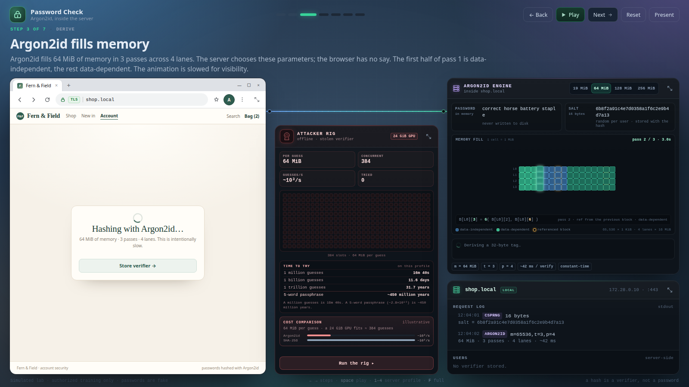
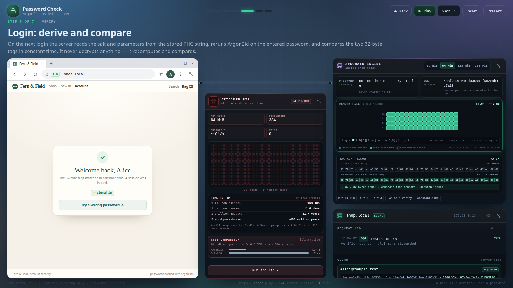
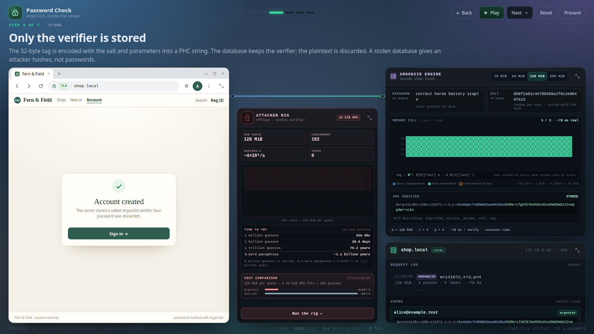
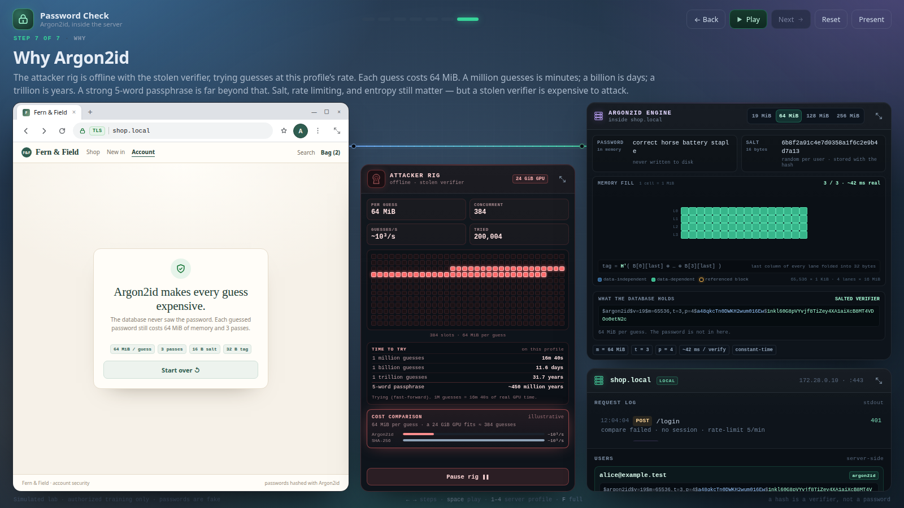
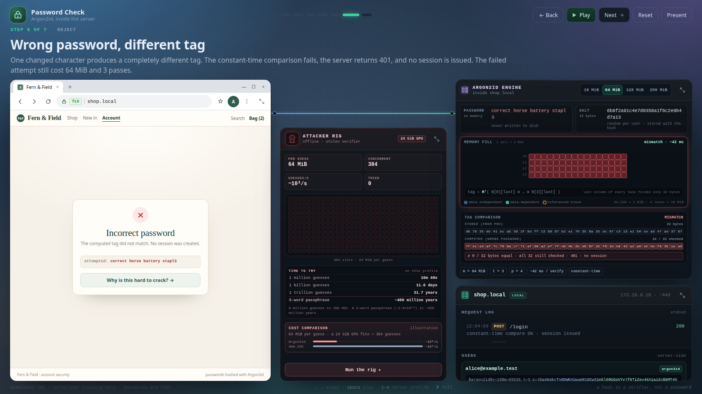

# Password Check — Argon2id Visual Lab

A companion to the [Cookie Theft lab](../cookie-theft/) in the same visual style: a light Chrome storefront on the left, an offline **attacker GPU rig** in the middle, and the **server** on the right. The Argon2id engine now lives inside the server column. A password is salted, run through Argon2id's memory-hard fill (64 MiB by default, or 19 / 128 / 256 MiB), stored as a PHC verifier, and recomputed at login — then the attacker rig shows what a stolen verifier is worth.



Open `index.html`. Single file, offline, no dependencies, no build step.

```bash
xdg-open index.html
# or
python3 -m http.server 8000   # then http://localhost:8000/argon2id/
```

Best at 1280×720 or larger. Below 1260px the stage stacks and the wire animation is disabled. Respects `prefers-reduced-motion`.

---

## The seven steps

| # | Step | What happens |
|---|------|--------------|
| 1 | A password arrives | Alice creates an account; the password crosses the wire over TLS and exists briefly in server memory. The browser sends only the password — the server chooses the salt and Argon2id parameters |
| 2 | A fresh random salt | 16 bytes from a CSPRNG, stored per user; the salt is public and not secret |
| 3 | Argon2id fills memory | The engine allocates the selected profile (default 64 MiB) and fills its lanes through the configured passes; the first half of pass 1 is data-independent, the rest data-dependent |
| 4 | Only the verifier is stored | A 32-byte tag is encoded with the salt and parameters into a PHC string; the plaintext is discarded |
| 5 | Login: derive and compare | The server reads the salt/params from the PHC string, reruns Argon2id, and compares the tags in constant time |
| 6 | Wrong password, different tag | One changed character gives a completely different tag; the constant-time compare fails; 401, no session |
| 7 | Why Argon2id | The attacker rig tries guesses offline; a million is minutes, a billion days, a trillion years; a strong passphrase is far beyond. Salt, rate limiting, and entropy still matter |



## Controls

| Action | Key / UI |
|---|---|
| Next / back | `→` / `←` (also PageDown / PageUp) |
| Play / pause | `Space`; waits for the current animation, then holds ~4.5 s before advancing |
| Jump to a step | Top-center dots |
| Reset | `R` |
| Cost profile | Engine-header selector (server-side), or `1` / `2` / `3` / `4` |
| Enlarge a panel | The **⤢** button in any panel header; `Esc` or click outside to restore |
| Fullscreen | `F`, or **Present** |
| Attacker rig | Starts automatically on the final step; the **Run the rig** button pauses or restarts the fast-forward attempt animation |
| Drive the browser | **Create account**, **Continue**, **Store verifier**, **Sign in**, **Try a wrong password**, **Why is this hard to crack?** |

Deep links:

```
index.html?step=3               # the derivation step
index.html?step=3&profile=high   # 128 MiB profile
index.html?step=3&profile=heavy  # 256 MiB profile
```

## Cost profiles

The selector lives in the **engine header**, inside the server column — not in the browser: the client sends only the password, and the server owns the salt and KDF parameters. The lab header above the stage contains only presentation controls (step navigation, Play, Reset, Present). Use the selector (or `1` / `2` / `3` / `4`) to change the cost. The salt stays the same; the tag and PHC are recomputed for the new parameters.

| Profile | m | t | p | Measured verify* | Animation |
|---|---|---|---|---|---|
| Light (OWASP minimum) | 19 MiB (19,456 KiB) | 2 | 1 | ~24 ms | 3.6 s |
| Balanced (default) | 64 MiB (65,536 KiB) | 3 | 4 | ~42 ms | 8 s |
| High | 128 MiB (131,072 KiB) | 3 | 4 | ~78 ms | 11 s |
| Very high | 256 MiB (262,144 KiB) | 4 | 4 | ~213 ms | 14 s |

\* Measured with argon2-cffi on one machine. Treat these as illustrative, not a benchmark.

The **animation is deliberately slowed** so the work is visible. The live timer under **MEMORY FILL** counts animation seconds; when it finishes, the same line shows the real measured cost. Switching profiles at the derivation step replays the derivation at the new cost. At later steps the verifier is recomputed in place so the rest of the story stays consistent.

The memory grid is **to scale**: **one block = 1 MiB = 1,024 real KiB blocks**. The profiles therefore show **19, 64, 128, and 256 blocks** — 128 is exactly 2× 64, and 256 is exactly 2× 128. Blocks stay the same square size (14 px, 13 px or 12 px on smaller screens); a bigger profile adds blocks rather than shrinking them. The exact 1 KiB totals — 19,456 / 65,536 / 262,144 — are shown beside the grid.



The **19 MiB / t=2 / p=1** profile follows OWASP's Password Storage Cheat Sheet minimum for Argon2id (19,456 KiB). **64 MiB / t=3 / p=4** is RFC 9106's second recommended option. **128 MiB** and **256 MiB** are valid, heavier demonstration profiles. The tags shown are real Argon2id outputs for each configuration.

The attacker rig changes with the profile too: 19 MiB/guess fits about 1,293 concurrent guesses in 24 GiB; 64 MiB fits 384; 128 MiB fits 192; 256 MiB fits 96. The guess-rate bars are illustrative.

## What a stolen verifier is worth

The center panel is an offline rig with a 24 GiB GPU. At the selected profile, 24 GiB holds that many concurrent guesses (384 at 64 MiB). The rig fast-forwards its attempts; the time table is the real arithmetic at the illustrative guess rate.

| Guesses | Time at ~1,000/s (64 MiB) |
|---|---|
| 1,000,000 | 16m 40s |
| 1,000,000,000 | ~11.6 days |
| 1,000,000,000,000 | ~31.7 years |
| 5-word passphrase (~2.8×10¹⁹) | ~450 million years |

A million guesses is a minute-scale warmup. Meaningful password search is billions to trillions of guesses, and a strong passphrase moves the target by many orders of magnitude. The rate is illustrative; the capacity arithmetic (24 GiB divided by memory-per-guess) is real.



---

## What is real (and what is illustrative)

The **cryptographic values are real**. Every profile has its own genuine Argon2id tag (and wrong-password tag) for the same password and salt. The balanced profile uses:

```
password:  correct horse battery staple
salt:      6b8f2a91c4e7d0358a1f6c2e9b4d7a13   (16 bytes)
params:    Argon2id v=19, m=65536 KiB (64 MiB), t=3, p=4, tag=32 B
tag:       d67925eb41bca5562f8dff138997b2e170356a25dc07c313e150cea347ad3767
PHC:       $argon2id$v=19$m=65536,t=3,p=4$a48qkcTn0DWKH2wum016Ew$1nkl60G8pVYvjf8TiZey4XA1aiXcB8MT4VDOo0etN2c
```

The tag and PHC strings were generated with `argon2-cffi` and can be verified with any standards-compliant Argon2id implementation. The wrong-password tag uses the same salt and parameters with `correct horse battery stapl3`; **0 of 32 bytes match** in all four profiles, which is the avalanche point the lab makes.

The PHC string is self-describing:

```
$argon2id$v=19$m=65536,t=3,p=4$<salt base64 no padding>$<tag base64 no padding>
```

The salt is 16 bytes (22 base64 characters); the tag is 32 bytes (43 base64 characters).

The **timing** is measured on one machine and varies by hardware; the **animation** is deliberately slowed to 3.6 / 8 / 11 / 14 seconds so the work is visible. The **cracker rates** (`~2×10²` to `~5×10³ guesses/s` depending on profile, versus `~10⁹/s` for SHA-256) are illustrative orders of magnitude. The arithmetic that matters is real: the GPU capacity values are just 24 GiB divided by the profile's memory cost.

The network is simulated; the browser form does not send anything.

---

## Why each detail matters

- **Salt.** Unique per account and stored with the verifier. It defeats precomputed tables and stops two users with the same password from sharing a verifier. It does not need to be secret.
- **Memory hardness.** Fast hashes are a gift to parallel hardware. Argon2id makes each guess allocate the chosen amount of memory (64 MiB by default), so an attacker's parallelism is bounded by memory, not just compute. Raising `m` costs an attacker memory; raising `t` costs both memory and time.
- **Argon2id specifically.** The hybrid mode runs the first half of the first pass data-independent (side-channel resistant, like Argon2i) and the rest data-dependent (like Argon2d).
- **Verification is recomputation.** The server cannot “decrypt” a hash. It parses the stored PHC string, reruns Argon2id with the same salt and parameters, and compares.
- **Constant-time comparison.** Comparing byte by byte and returning early on the first mismatch leaks how many prefix bytes were right. Libraries compare the whole tag in constant time.
- **PHC params are upgradeable.** If you raise `m`/`t` later, the stored string tells the server which parameters were used; it can rehash on the next successful login.
- **Rate limiting.** Hashing makes each online guess expensive, but an attacker can still try. Enforce attempt limits and monitor velocity.
- **Entropy still matters.** Memory hardness makes cracking expensive, not impossible. A weak password remains weak.



## Suggested questions for students

1. At which step does the plaintext password stop existing on the server?
2. Why can the server verify a password without storing it?
3. Why does the salt not need to be secret? What would go wrong with one global salt?
4. What does a database leak actually contain here?
5. Why is SHA-256 a poor choice for passwords even though it is cryptographically strong?
6. What does constant-time comparison protect against, and what does it not protect against?
7. What happens if you raise the Argon2id parameters a year later? How does the PHC string help?
8. Where does rate limiting fit if the hashes are already expensive?
9. At this profile's rate, how long is 1 million guesses? 1 billion? 1 trillion?
10. How many concurrent guesses fit on a 24 GiB GPU at each profile, and why does that matter more than raw clock speed?
11. Compare 19 MiB / t=2 with 64 MiB / t=3. Which change makes a bigger difference to an attacker, and what does it cost your login server?
12. Which profile would you pick for a high-traffic login endpoint? What is the user-facing trade-off?

## Customizing

Everything lives in `argon2id/index.html`:

- **Cost profiles** — the `PROFILES` object near the top of the script holds `m`, `t`, `p`, the measured time, the animation duration, the real tags, and the cracker estimates for each profile. If you change the password, salt, or parameters, regenerate the good and wrong tags for that profile:

```python
import base64
from argon2.low_level import hash_secret_raw, Type

salt = bytes.fromhex("...")
pw = b"correct horse battery staple"
tag = hash_secret_raw(pw, salt, time_cost=3, memory_cost=65536,
                      parallelism=4, hash_len=32, type=Type.ID, version=19)
b64 = lambda b: base64.b64encode(b).decode().rstrip("=")
print(b64(salt), b64(tag))
```

- **Narration** — the `STEPS` array.
- **Parameters shown in the UI** — the engine footer chips, the PHC string, and the server log text.
- **Timing and cracker rates** — labeled illustrative; edit the chips/`cracker` block if you want different teaching numbers.

## Note

Simulated lab for authorized training only. The credentials and session values are fake. This page does not hash anything at runtime; it visualizes values that were generated offline.
