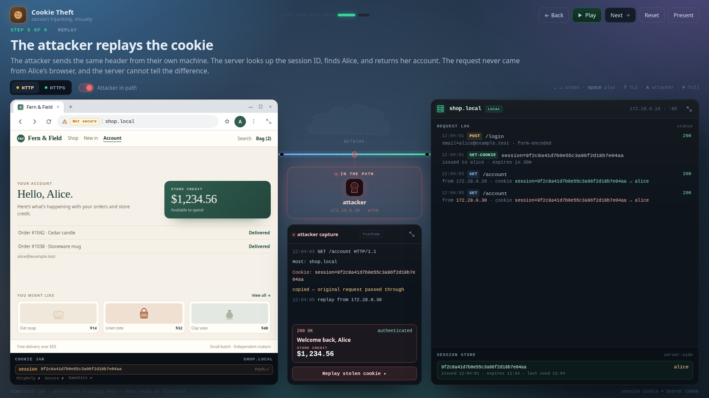
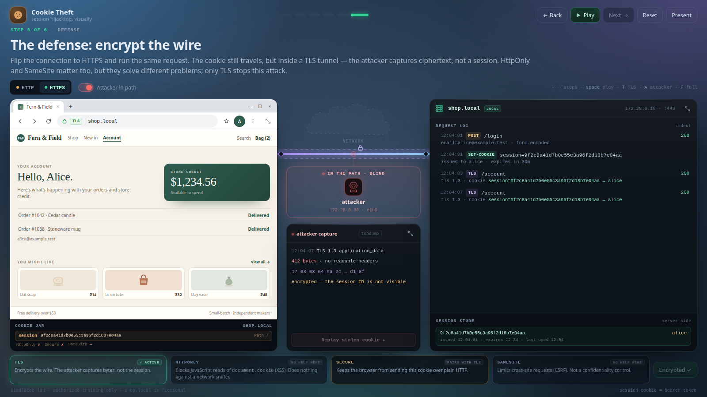

# Cookie Theft — Visual Lab

> **More labs:** [Password Check — Argon2id](../argon2id/) — server-side password verification in the same visual style.

A single-file, offline, projector-friendly walkthrough of **session hijacking**: a browser logs in, the server issues a session cookie, the browser sends it back, and an attacker on the wire copies and replays it.



No build step, no server, no dependencies. Open `index.html` in a browser.

```bash
xdg-open index.html          # Linux
open index.html              # macOS
# or serve it, if you prefer:
python3 -m http.server 8000  # then visit http://localhost:8000
```

Best at **1280×720 or larger**. Below 1100px the layout stacks vertically and the wire animation is disabled (everything else still works). Honors `prefers-reduced-motion`.

---

## What the students see

A single stage with the victim's browser on the left, the server on the right, and the attacker tapping the wire between them. The session cookie is drawn as a ticket (`🍪 session=…`) that physically travels the wire. When it passes the tap, a red copy peels off and drops into the attacker's capture panel. The `Set-Cookie` reply physically drops a cookie into the browser jar, and **Replay** lifts the stolen cookie up out of the capture and back onto the cable.

The **⤢** control in the browser, capture, and server headers enlarges a panel over a blurred backdrop; `Esc` or clicking outside restores it. This is handy for reading the full cookie and server records on a projector.

The six steps:

| # | Step | What happens on screen |
|---|------|------------------------|
| 1 | One network, one attacker | Login page, idle server, attacker tapping the wire |
| 2 | Alice logs in | `POST /login` packet flies to the server |
| 3 | The server issues a cookie | Server mints a session ID; green `Set-Cookie` ticket flies back; jar fills |
| 4 | Every request carries the cookie | `GET /account` with `Cookie: session=…`; attacker copies it; account renders |
| 5 | The attacker replays it | Red replay ticket goes attacker → server; server returns Alice's balance |
| 6 | The defense: encrypt the wire | Flip to HTTPS; same request, but the capture is ciphertext |

### Controls

| Action | Key / UI |
|---|---|
| Start / continue the login | Click **Sign in** in the browser, then **Continue to /account** |
| Next / back | `→` / `←` (also PageDown / PageUp) |
| Play / pause | `Space`; auto-advances every ~3.8 s |
| Jump to a step | Top center dots |
| HTTP ↔ HTTPS | The segmented control, or `T` |
| Attacker in path / off | The toggle, or `A` |
| Reset | `R` |
| Fullscreen (present) | `F` or the **Present** button |
| Replay the stolen cookie | The button in the capture panel |
| Enlarge a panel | The **⤢** button in the browser, capture, or server header; `Esc` or click outside to restore |

Deep links, useful for lesson plans or bookmarks:

```
index.html?step=4                  jump to step 4 (1-based)
index.html?step=6&https=1          defense step, already on HTTPS
index.html?step=4&attacker=0       same story with no attacker
```

---

## Suggested teaching script

**Step 1 — Setup.** Ask where Alice's identity lives once she is logged in. If someone is on the same Wi-Fi, what can they see? Establish that the connection is plain HTTP, so the wire is readable.

**Step 2 — Login.** Only `POST /login` travels. There is no session yet, so the browser has nothing to attach. The password is verified once; something else must keep her logged in.

**Step 3 — Session.** Point at both sides: the **server-side session store** holds `session → alice`, and the **browser cookie jar** holds the ID. The server generated a random ID; the browser was simply handed it. Note the response header: `Set-Cookie`.

**Step 4 — The cookie returns.** This is the core idea. The `Cookie: session=…` header is the *only* thing identifying Alice. It is a **bearer token**: possession is identity. The attacker lets the original request through untouched, so Alice notices nothing.

**Step 5 — Replay.** Look at the server log: the replay came from `172.28.0.30` instead of `172.28.0.20`, yet the server returned the same account. Sessions are looked up by ID, not by who is asking. Ask: what could the server have done to notice?

**Step 6 — Defense.** Flip the connection to HTTPS (or use the **Run over HTTPS** button). The cookie still travels, but the capture panel shows TLS application data instead of a readable header. Then use the four cards to separate the controls:

- **TLS** is what stops *this* attack — encryption in transit.
- **HttpOnly** stops JavaScript reading `document.cookie` (XSS). It would not have helped at all here.
- **Secure** keeps the browser from sending the cookie over plain HTTP.
- **SameSite** limits cross-site requests (CSRF); it is not a confidentiality control.



A good closing question: *"If the attacker steals the cookie after the victim logs in, what can the server do to limit the damage?"* Useful answers: short expiry, rotate the session on privilege change, bind or fingerprint the session (with usability trade-offs), detect impossible-travel/velocity, and provide server-side revocation.

---

## What is real, and what is not

The **protocol semantics are real**: `Set-Cookie`, `Cookie: session=…`, a server-side session table, bearer-token identity, cleartext HTTP versus TLS. The **network is a simulation** — there is no traffic, no Docker, no sniffing. Everything is state inside one HTML file. That makes it deterministic and presentation-safe, but it is not a hands-on attack.

If students need to perform the attack themselves, run a real lab afterwards (sketch below).

### Taking it live (optional)

The simplest real version is three containers on one user-defined bridge:

```text
browser container  ──  attacker container  ──  web app container
  cookie jar            ARP spoof / tcpdump       Flask + Set-Cookie
```

- **Server**: a tiny Flask/Express login that issues `Set-Cookie: session=<random>` and validates it on `/account`. Log every request and the cookie received.
- **Victim**: `curl -c jar -b jar` in a loop, or Chromium/noVNC if you want a visible browser. Keep the client *inside* the lab network; pointing the host browser at a published port bypasses the bridge, so the attacker will not see the traffic.
- **Attacker**: needs a container on the same bridge with `cap_add: [NET_ADMIN, NET_RAW]` and `net.ipv4.ip_forward=1`. Use `bettercap` or `arpspoof` + `tcpdump`; extract the header and replay it with `curl -H "Cookie: session=…" http://server/account`.
- A Docker bridge is a switch, so passive sniffing in the attacker container sees only broadcast traffic. ARP spoofing puts the attacker in the path deterministically.
- For a network-focused audience, **Mininet + Open vSwitch** is arguably better: three hosts and a mirror port (`ovs-vsctl set Bridge s1 mirrors=…`) gives the attacker a real SPAN-style tap without ARP games.

Then harden the same app: TLS, `Secure; HttpOnly; SameSite=Lax`, short expiry, session rotation — and rerun the capture to show the same attack failing.

---

## Customizing

Everything lives in `index.html`:

- `COOKIE` near the top of the script — the demo session ID.
- `STEPS` — titles, tags, and narration text. Edit these to match your course's wording.
- `accountHTML()` — Alice's account page and balance.
- `renderServer()` / `renderCapture()` — the log entries and capture text.
- Timings: search for `1050`, `1150`, `1500` (packet durations) and `3800` (auto-play interval).
- Colors and fonts: CSS variables at the top of the `<style>` block.

There are no external fonts, images, or network requests. The screenshots in this README were generated with headless Chrome.

---

> Simulated lab for authorized training only. `shop.local`, the credentials, and the session ID are fictional. If you build the live version, keep it on an isolated network; ARP spoofing on a network you do not own is a real attack.
